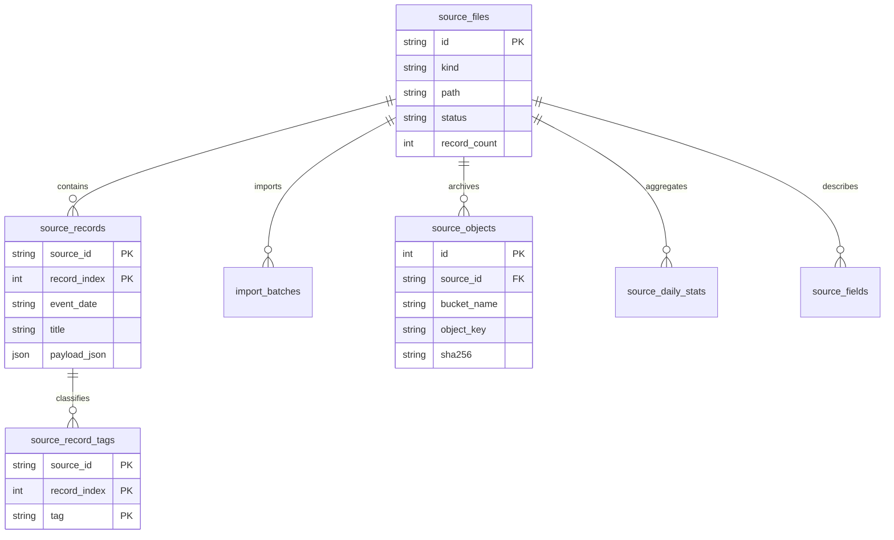
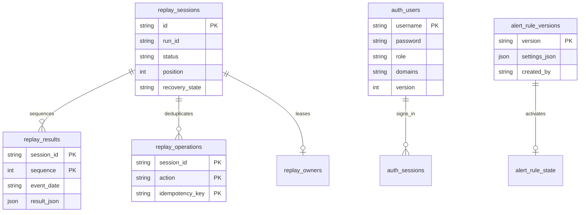
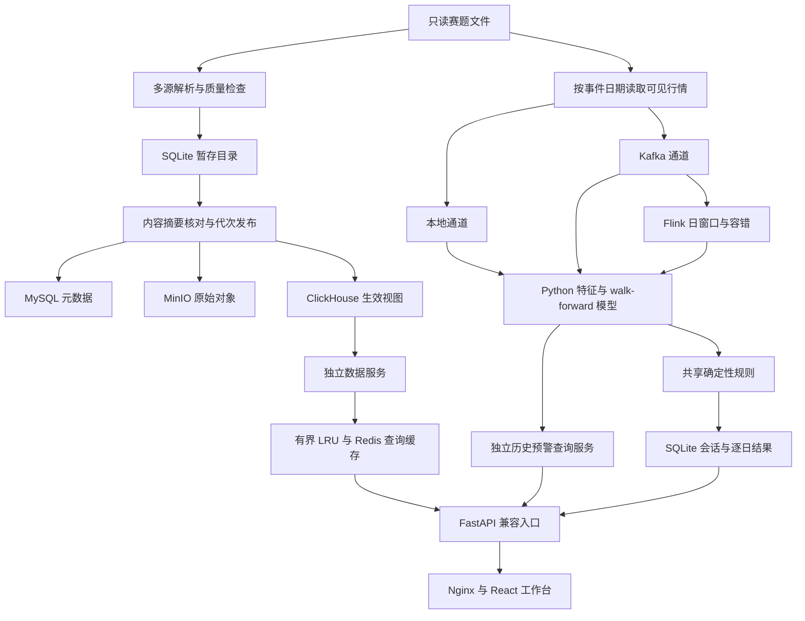

# 当前数据模型与数据流

核查日期：2026-11-11。以下记录已实现结构；连线表示应用逻辑关联，不代表跨库外键或分布式事务。实体字段为关键字段摘录，完整 schema 以迁移文件及 Store 初始化代码为准。

`v0.3.5` 状态身份变更：状态 JSON 新增 `regime_id`、`regime_identity`，原 `cluster` 仍是局部簇编号；模型版本前缀区分新旧算法。回放会话快照 JSON 新增 `model_identity`，无需改表；旧快照缺字段时采用 `local-cluster-v1`，新建默认 `centroid-alignment-v1`。已有 `result_json` 不迁移或改写，前端兼容缺少新字段的历史结果。详见 [字段与兼容约定](v0.3.5-regime-identity.md#api-与持久化兼容)。

## 数据目录与原始血缘

`v0.4.0` 开发首批新增特征元数据 API，区分 `feature_version`、目录 `data_version`、行情 `input_version`。新会话 `snapshot_json` 保存 `calculation_contract`（模型参数、两个实际使用的回放分位数、特征定义、截至日行情摘要与契约版本）及 `lineage_status=pinned`，无需 SQL 改表；旧快照无契约为 `legacy-unpinned`，已有 `result_json` 不迁移。摘要是派生行情输入的标识，不等于原始文件摘要或防篡改签名。详见 [契约定义](v0.4.0-feature-contracts.md)。

SQLite 是导入暂存与本地模式目录；MySQL 存目录/批次/对象元数据，MinIO 存原始对象；ClickHouse 存发布代次的记录、统计和生效视图。发布指针只有在内容摘要与数量核对后更新。来源 ID、记录序号和内容摘要贯通血缘。

## 会话、身份与规则

回放、身份和规则版本当前使用 SQLite；`password` 保存强哈希，不是明文。审计归档写 MinIO 并保留 SHA-256 回读核对。不能把目标架构中的“MySQL 身份/规则库”写成当前实现。

## 当前数据流

Java Flink 负责事件时间、窗口、去重、迟到分流及 Checkpoint/Savepoint；金融算法仍为同一 Python 实现。REST 查询、GraphQL 组合和 WebSocket 推送共享鉴权；逐日回放不增加到预警服务的网络依赖。

## 统一记录与生命周期

目录记录以 `(source_id, record_index)` 标识，保留 `kind/event_date/title/payload`；回放事件增加会话、运行和事件时间，结果以 `(session_id, sequence)` 排序。来源时间含义不明确时保留原字段并排除出需严格时序的计算。

ODS 为原始文件/对象和 payload，DWD 为标准化记录与标签，DWS 为日期/字段/标签统计，ADS 为 API 查询与市场结果。当前分层是职责映射；不是四套完整独立数仓。旧发布代次自动清理、统一保留周期与跨库灾备仍需完善。
- 2026-11-12 来源治理报告为现有目录与政策的派生视图，不新增持久表：来源类型、记录/日期/字段证据、用途和时间限制，以及人工保留策略；重复/异常与未确定期限用 null。报告携带目录/政策版本，生成期间版本变化返回重试错误，不改变现有记录或事实源。详见 [专项报告](v0.4.0-source-governance.md)。
- 逐文件 `file-governance-v1` 同样不新增表，按 `source_id` 读文件元数据、日期统计、字段统计。字段空缺是文件记录数减非空数，多 Sheet 合并；历史全空字段可能未登记，不能视为完整 schema/必填审计。字段最多查询 101、展示 100，比例在空文件/未完成导入/统计范围异常时为 null；重复/语义异常未评估。详见 [逐文件报告](v0.4.0-file-governance.md)。
